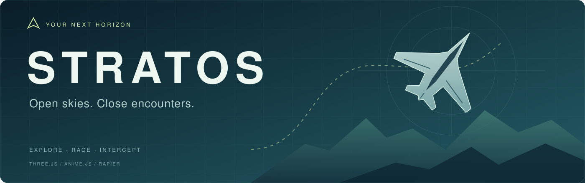
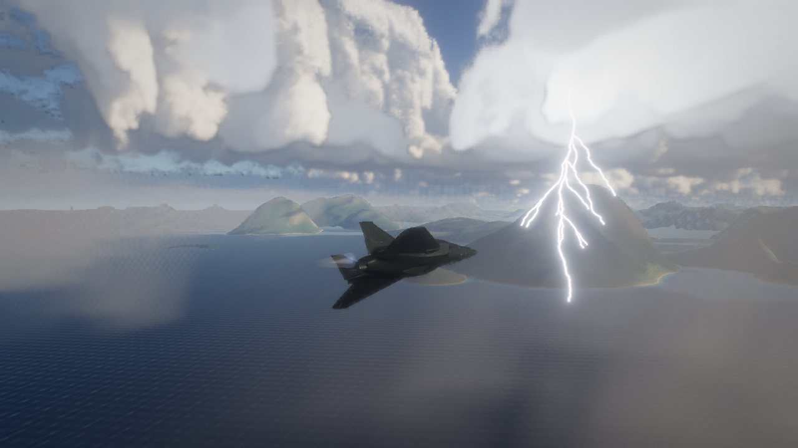
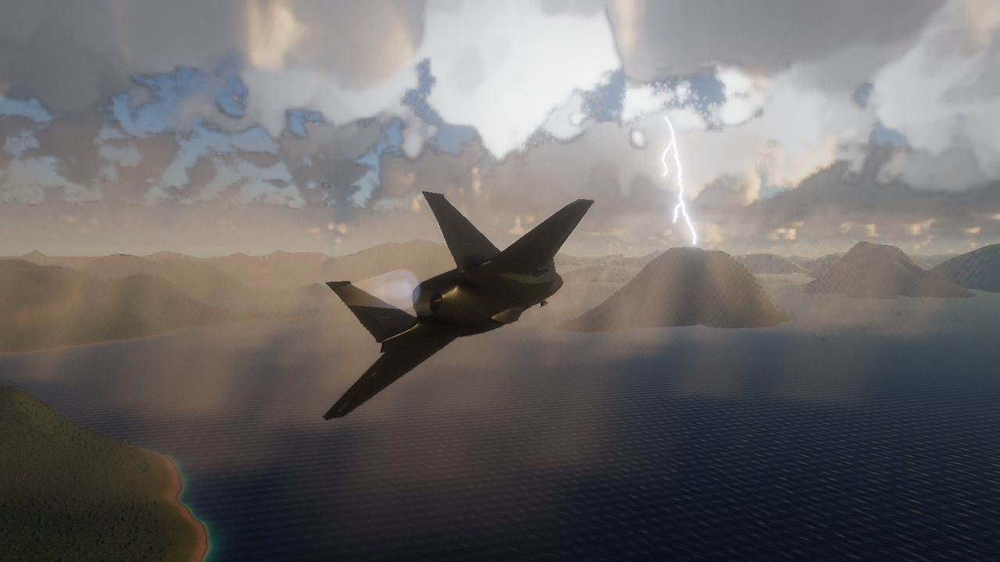
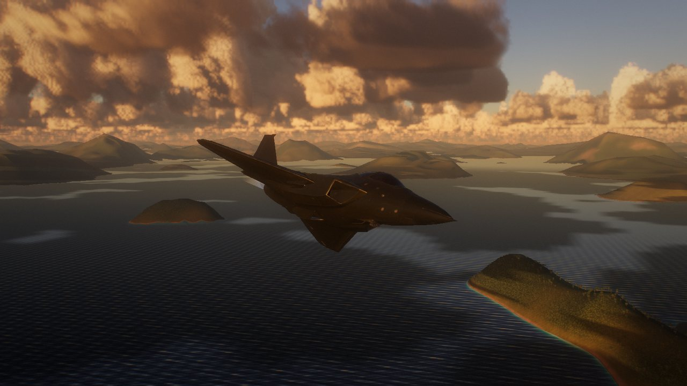
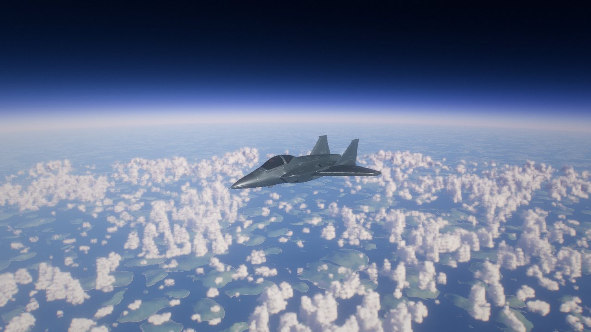
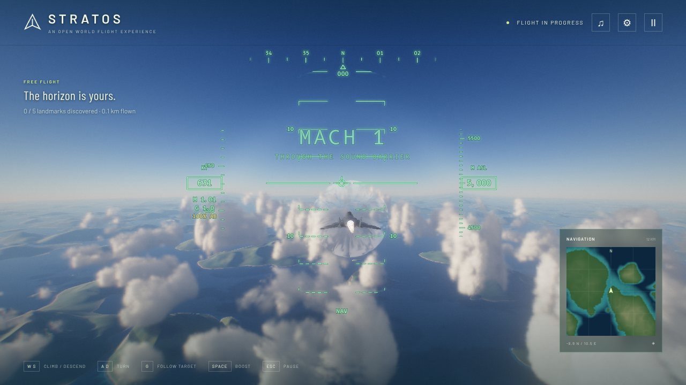
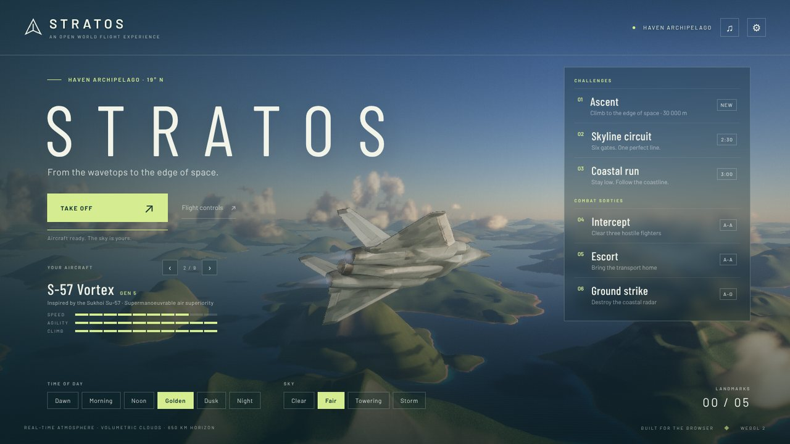
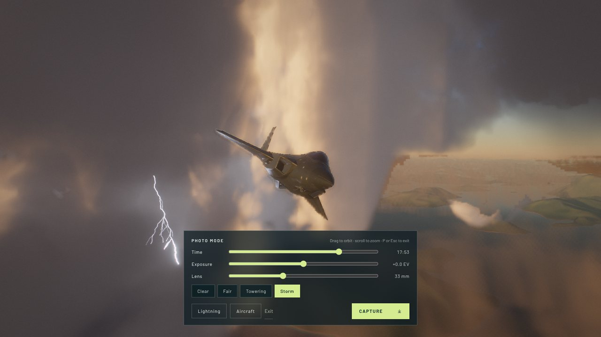
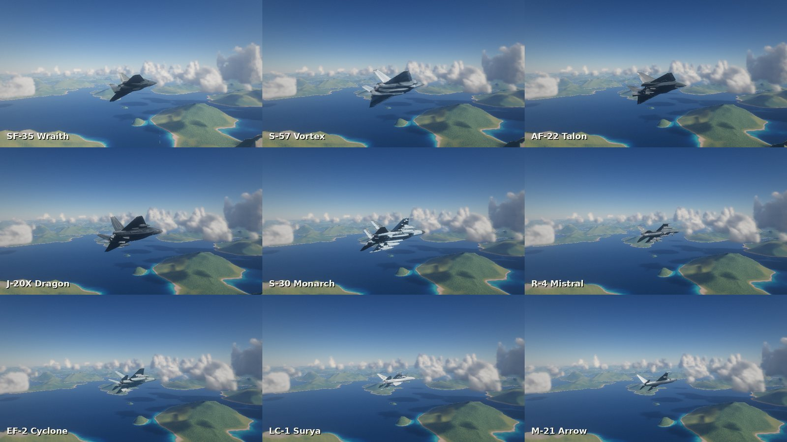

<div align="center">

**An open-world fighter jet game, built for the browser.**

From the wavetops to the edge of space: a physically based sky, volumetric thunderstorms,
an archipelago drawn to a 650 km horizon, and nine fighters to fly through it.

**Three.js · WebGL 2 · anime.js · Rapier · TypeScript · Vite**

[Gallery](#gallery) · [Get started](#get-started) · [How to play](#how-to-play) · [The fleet](#the-fleet) · [Controls](#controls) · [Under the hood](#under-the-hood) · [Credits](#asset-credits)

</div>



## Your next horizon

Stratos is a single-player flight and combat game set in Haven, a tropical archipelago at 19° N.
Skim the coast at sunrise, thread checkpoint gates, dogfight between storm cells, or climb
through the tropopause until the sky turns black and the curve of the Earth shows.

Pick the hour and the weather on the title screen and take off straight out of the cinematic.
Easy flight controls and target-follow assistance let you focus on the view and the action;
Advanced mode unlocks full loops and rolls.

| Fly your way        | What awaits                                                                    |
| ------------------- | ------------------------------------------------------------------------------ |
| **Free flight**     | Explore Haven, find five landmarks, and start a patrol whenever you like.      |
| **Ascent**          | Climb from the sea to 30 000 m against the clock: the edge of space.           |
| **Skyline circuit** | Six checkpoint gates and a race against the clock.                             |
| **Coastal run**     | Follow the coastline while staying below the altitude limit.                   |
| **Intercept**       | Clear three hostile fighters from the airspace.                                |
| **Escort**          | Protect a transport as it flies to safety.                                     |
| **Ground strike**   | Destroy an enemy radar site guarded by fighters.                               |
| **War · Iron Dawn** | Lead two wingmen: intercept, low ingress, bombing run, then the counterattack. |

## Gallery

Every image is a real-time frame from the game (photo mode or the title cinematic).

| | |
| --- | --- |
|  |  |
| **Under the storm.** Rain shafts, crepuscular light and lightning. | **Dusk.** Multiple-scattering cumulus lit by a low sun. |
|  |  |
| **The edge of space.** 29.5 km up: black sky, the limb, a curved horizon. | **Through the sound barrier.** Vapour cone, boom and conformal HUD. |
|  |  |
| **Title screen.** Hangar, time of day and sky before take-off. | **Photo mode.** Freeze the world, orbit, re-light, strike, capture. |

## What's in the sky

- **Atmosphere from sea level to 30 km.** Hillaire-style precomputed transmittance,
  multiple-scattering, sky-view and aerial-perspective LUTs on a curved planet; Earth's shadow,
  twilight, stars, Milky Way and the moon; the horizon dips as you climb.
- **Volumetric clouds.** Raymarched fair-weather cumulus, towering cumulus and cumulonimbus with
  anvils from GPU-generated Perlin–Worley noise, a three-lobe phase function, multiple-scattering
  octaves and powder, cloud shadows on land and sea. Rendered at reduced resolution with
  checkerboard tracing and depth-aware temporal reconstruction that holds up at Mach 2.
- **Thunderstorms.** Branching cloud-to-ground and intra-cloud lightning placed under real
  storm cores, lighting the cloud from inside and the land below; thunder arrives at the speed
  of sound; rain shafts hang from storm bases.
- **An archipelago to the horizon.** GPU CDLOD terrain with an 11-level clipmap streams the
  islands out to a 650 km horizon on a curved Earth, with forests, beaches, reefs and
  heightfield shadows. The analytic ocean has glitter, Fresnel and shallow-water colour.
- **Supersonic flight.** A Mach-aware flight model (ISA density, thrust lapse, transonic wave
  drag), vapour cones, sonic booms with a screen shock ripple, afterburner shock diamonds per
  engine, contrails above 8.5 km and wingtip vortices in hard pulls.
- **Two air bases.** Every sortie starts on the runway at **Haven**, the home base, with
  parked jets, a tower, hangars, edge and approach lights and PAPI. **Blackridge**, the enemy
  base on the north coast, has a rotating radar, a fuel farm and aircraft shelters to strike.
- **Air defences.** Radar-guided and heat-seeking SAM sites detect you by radar cross-section,
  terrain line of sight, ground clutter below 100 m and the Doppler notch, so stealth jets low in
  the valleys get much closer. Heat-seekers can be decoyed by magnesium flare salvos.
- **People on the ground.** Mixamo-animated soldiers and ground crew drill, jog, chat, patrol
  and salute at both bases; Blackridge's guards fall when their installation is destroyed.
- **Supermanoeuvres and damage.** A physics-driven cobra (airbrake plus a hard pull) that turns
  into a full 360° kulbit in thrust-vectoring jets, airbrake,
  engine shutdown and relight, differential thrust on twin-engine jets, and missile hits that
  set one engine on fire and then the other.
- **A fighter HUD.** Conformal pitch ladder, flight-path marker, speed/altitude tapes, Mach, G,
  lead pipper and target boxes, with milestones at the tropopause and the stratosphere.
- **HDR post.** Physically based exposure with eye adaptation, bloom, crepuscular rays, lens
  flare and ACES tonemapping; dynamic resolution holds the frame rate.
- **Sound.** ElevenLabs-generated engine, afterburner, wind and rain loops, sonic boom, thunder,
  cannon, missile and explosions, with synthesized fallbacks. Flare salvos pop and fizz away
  behind the jet.
- **Haven Control on the radio.** A voiced controller briefs each sortie, calls the tropopause,
  the stratosphere and the edge of space, laughs at your first sonic boom, shouts the missile
  break, counts your kills and goes very quiet when you don't come back. Lines run through a
  compressed, band-limited radio chain with squelch, carrier static that thickens in storms and
  the odd dropout where the signal breaks up; urgent calls cut in over chatter, with subtitles.

## The fleet

Choose your aircraft in the hangar on the title screen. Each has its own performance, engine
layout (single or twin plumes and contrails) and handling; hostile fighters are drawn from the
rest of the fleet.



| Aircraft          | Generation | Inspired by                    | Character                                       |
| ----------------- | ---------- | ------------------------------ | ----------------------------------------------- |
| **SF-35 Wraith**  | 5          | F-35 Lightning II              | Balanced stealth multirole                      |
| **S-57 Vortex**   | 5          | Sukhoi Su-57                   | Supermanoeuvrable air superiority               |
| **AF-22 Talon**   | 5          | Lockheed Martin F-22 Raptor    | Stealth air dominance, supercruise              |
| **J-20X Dragon**  | 5          | Chengdu J-20                   | Long-range interceptor, fast and less agile     |
| **S-30 Monarch**  | 4++        | Sukhoi Su-30MKI                | Heavy twin-seat, the most agile in the hangar   |
| **R-4 Mistral**   | 4.5        | Dassault Rafale                | Canard-delta omnirole                           |
| **EF-2 Cyclone**  | 4.5        | Eurofighter Typhoon            | Canard-delta, outstanding thrust                |
| **LC-1 Surya**    | 4.5        | HAL Tejas                      | Light tailless delta, nimble and slippery       |
| **M-21 Arrow**    | 3          | Mikoyan-Gurevich MiG-21        | Cold War interceptor: quick, but turns wide     |

## Get started

Use **Node.js 22.12+** and npm, with a desktop browser that supports **WebGL 2**. A discrete GPU
is recommended; dynamic resolution and three quality presets scale the work down.

```sh
git clone https://github.com/TejasGov/Stratos.git
cd Stratos
npm ci
npm run dev
```

Open the local URL printed by Vite and wait for the aircraft and terrain materials to load. All
assets are in the repository; no asset-service account or API key is needed to play.

To serve a production build locally:

```sh
npm run build
npm run preview
```

## How to play

On the title screen, choose an aircraft in the hangar, the time of day (dawn to night) and the
sky (clear, fair, towering or storm), then **Take off** to fly on from the cinematic, or pick a
challenge or sortie.

Every flight opens with a short shot over Haven's apron (any key skips it), then starts parked
on the runway. Hold **Shift** to spool up (add **Space** for afterburner), pull **W** at the
ROTATE cue and climb out. To come home, cross the hills at the end of the runway, then fly a
shallow final with the nose a couple of degrees down and the throttle at idle. The flight path
follows the nose, so pulling up to flare climbs away instead. Touch down under 5 m/s sink with
wings level, then hold **Z** to brake.

For a first climb, choose **Ascent**: hold **Space** for afterburner and pitch up. Thin air means
more speed and softer controls; the HUD calls out the tropopause, the stratosphere and the edge
of space.

For a first dogfight, choose **Intercept**. Target follow starts enabled: the jet steers toward
the selected fighter and adjusts thrust to help you stay with it.

1. Hold **left mouse / F** to fire the cannon.
2. Tap **right mouse / X** for a missile. A tap queues briefly while the lock finishes.
3. Use **T** to select another target and **V** when an incoming missile threatens you.
   A prompt bar near the bottom of the screen always shows the key that matters right now.
4. Press **G**, or use the HUD button, to toggle target follow. **WASD** takes manual control.

The lead pipper shows the cannon's predicted intercept point. Missile lock feedback explains when
a target is out of alignment, too far away, obstructed, or waiting for cooldown.

### War · Operation Iron Dawn

The longest sortie, commanded over the radio by **Citadel**, a British air officer. Two AI
wingmen, **Viper 2** and **Viper 3**, form up on you after takeoff and fight on their own; they
can be shot down. The operation runs in four phases:

1. **Intercept.** Clear three bandits coming down from Blackridge.
2. **Ingress.** Fly through three lit markers up the eastern channel, under 450 m, below the
   battery radar.
3. **Bombing.** Viper 2 bombs the SAM sites and Viper 3 the targets (three bombs each). Release
   yours with **N**: each of the eight bombs is powered and dives like a missile onto the selected
   ground target (or the **BOMB** pipper point), and its 330 m blast also takes out SAMs and
   installations nearby.
4. **Counterattack.** Four more bandits come in from 15 km north; hold the line.

Before take-off you choose **Checkpoints** (shot down, you fly again from the start of the phase
you reached, with the targets, bombs and wingmen you had then) or **Pro** (one life). The minimap
zooms out to 20 km for the wider battle area.

### Photo mode

Press **P** (or choose it from the pause card) to freeze the world. Drag to orbit the jet, scroll
to zoom, and adjust time of day, exposure, lens and sky. **Lightning** freezes a strike in front
of the camera, **Aircraft** hides the jet, and **Capture** saves a full-resolution PNG.

### Flight that fits you

**Easy mode is the default.** A/D turns directly, W/S climbs or descends, and releasing the
controls levels the aircraft. Move the mouse over the sky to steer when target follow is off.

**Advanced mode**, available in Settings, restores bank-based turns and unrestricted aerobatics.
Settings also include pitch inversion, sensitivity, remappable combat keys, camera shake, HUD
scale, sound, radio chatter, dynamic resolution, three graphics presets and a performance readout.

Your aircraft, time of day, sky, preferences, discoveries and records are saved in the current
browser.

## Controls

| Input                     | Action                                   |
| ------------------------- | ---------------------------------------- |
| **W / S** or **↑ / ↓**    | Climb / descend; pitch in Advanced mode  |
| **A / D** or **← / →**    | Turn left / right; bank in Advanced mode |
| **Q / E**                 | Rudder left / right                      |
| **Shift / Ctrl**          | Increase / decrease thrust               |
| **Space**                 | Afterburner                              |
| **Z** — hold              | Airbrake; wheel brakes on the ground     |
| **Z** + pull (**W**)      | Cobra; hold the pull for a 360° kulbit   |
| **I**                     | Engine master: shut down / relight       |
| **C**                     | Chase / forward camera                   |
| **P**                     | Photo mode                               |
| **Left mouse / F** — hold | Fire cannon                              |
| **Right mouse / X** — tap | Launch or queue a guided missile         |
| **T**                     | Cycle targets                            |
| **V**                     | Deploy countermeasures                   |
| **N**                     | Release a bomb (War and Ground strike)   |
| **G**                     | Toggle target follow in Easy mode        |
| **B**                     | Start / leave an intercept patrol        |
| **R**                     | Restart the current flight or sortie     |
| **Esc**                   | Pause / resume                           |

Combat keys are remappable. If G is assigned to a weapon action, use the HUD button for target follow.

### Standard gamepad

| Input                    | Action                        |
| ------------------------ | ----------------------------- |
| Left stick               | Fly                           |
| Right stick — horizontal | Rudder                        |
| Right / left trigger     | Increase / decrease thrust    |
| A / B                    | Cannon / missile              |
| X / Y                    | Countermeasure / cycle target |
| LB                       | Afterburner                   |
| RB                       | Airbrake / wheel brakes       |
| RB + left stick back     | Cobra / kulbit                |

Standard gamepad mappings have automated coverage; physical devices and HOTAS support still need
hardware testing. Gamepad B fires a missile; keyboard B starts a patrol.

## Under the hood

| System                 | Implementation                                                                                                                                                                                                             |
| ---------------------- | -------------------------------------------------------------------------------------------------------------------------------------------------------------------------------------------------------------------------- |
| **Frame**              | Opaque scene into a multisampled HDR target → clouds → one composite pass for atmosphere, analytic ocean and clouds that also writes depth → transparent effects → bloom, rays, flare, eye adaptation, ACES.              |
| **Atmosphere**         | Transmittance 256×64, multiple scattering 32×32, horizon-aware sky view 192×108 and a 32-slice aerial-perspective volume over 96 km, rebuilt every frame in a camera-centred planet frame; image-based lighting from the sky. |
| **Clouds**             | 128³ Perlin–Worley and 32³ Worley volumes and a 512² weather map generated on the GPU; adaptive raymarch with a six-step light march; 2×2 checkerboard tracing, offset-aware reconstruction and variance-clipped history.   |
| **Weather**            | Coverage, storm systems and cell types from the weather map (mirrored on the CPU for lightning placement and rain audio); lightning bolts as view-facing HDR quads occluded by the cloud layer; rain shafts in the march.   |
| **Terrain**            | GLSL port of the gameplay height function, bit-exact with the CPU; 11-level 512² clipmap in a texture array; instanced CDLOD patches with geomorphing and skirts; Earth curvature; heightfield-raymarched shadows.           |
| **Flight & collision** | Fixed-step simulation with interpolated rendering; ISA density, Mach, thrust lapse, wave drag and G; per-airframe performance; collision against the drawn clipmap surface with Rapier heightfields and swept checks.      |
| **Combat**             | Bounded enemy steering, pooled missiles and tracers, predictive cannon assistance, swept moving-target hits, health and countermeasures; enemy airframes from the fleet.                                                     |
| **Effects**            | Vapour cone, boom shells, per-engine afterburner plumes with shock diamonds, ribbon contrails and vortices, instanced smoke and fire.                                                                                        |
| **Interface & audio**  | Canvas conformal HUD, anime.js title cinematic and transitions, hangar and photo mode; sample-based audio on a master bus, thunder delayed and low-passed by distance; prioritised radio voice with subtitles and ducking.                                                  |

## Development

```text
src/
├── main.ts              Game loop, title cinematic, hangar, photo mode and integration
├── aircraft.ts          Fleet: models, nozzles, wingtips and performance
├── flight.ts            Mach-aware flight model, Easy and Advanced handling
├── audio.ts             Sample layers, thunder, boom, radio chain and synthesized fallbacks
├── comms.ts             Haven Control: radio lines, priorities, cooldowns and subtitles
├── sky/                 Atmosphere LUTs, clouds, lightning, composite and post
├── world/               Height function, GPU clipmap terrain, scenery, air bases, crowds
├── effects/             Supersonic effects, pooled particles and trails
├── combat/              Missions, enemy AI, weapons and visuals
├── render/              Terrain materials, dynamic resolution, telemetry
├── ui/                  Canvas HUD
├── input/               Keyboard and standard gamepad actions
└── physics/             Rapier collision and query world
public/assets/           Aircraft fleet, SAM vehicles, characters, audio, voice, Poly Haven materials
tests/                   Simulation, terrain, combat, input, fleet and asset checks
docs/                    Research and implementation notes
```

```sh
npm test          # Run automated tests
npm run build     # Type-check and build into dist/
```

The suite has **114 tests** covering flight stability and frame-rate independence, runway
takeoff and simulated-pilot landings in every jet, the cobra, engine failure, air-defence detection and decoys, base layout
and crowd placement, collision and rebasing, the collision surface matching the drawn terrain, streaming, weapons and kills,
aim-assist limits, input buffering, bounded effects, fleet geometry and ratings, dynamic
resolution and asset integrity.

Development builds expose the game as `window.stratos` for console exploration; production builds
do so only with `?debug` in the URL.

Background reading: [rendering research notes](docs/research/rendering.md) (atmosphere, clouds,
ocean, post), [world, combat and terrain research](docs/research/README.md), and the
[implementation notes](docs/IMPLEMENTATION_STATUS.md).

## Asset credits

**Aircraft.** All nine fighters were generated for this project with [Meshy](https://www.meshy.ai)
text-to-3D (2K PBR textures), then optimized with glTF Transform (meshopt geometry, WebP textures):
about 49 000 triangles and 1.2–1.6 MB each. Designs are original interpretations inspired by the
real aircraft named in the fleet table; nozzle exits and wingtips were measured from the meshes to
place engine effects. Cockpit interiors and animated control surfaces are not included.

**Characters.** Soldiers and ground crew (Swat Guy, Steve, David, Pete, Alex, Gas Mask) and
their animations are from [Adobe Mixamo](https://www.mixamo.com), converted with
`scripts/mixamo-to-glb.py`; the list is in the
[character manifest](public/assets/characters/mixamo/manifest.json). SAM launcher and radar
vehicles were generated with Meshy ([defence notes](public/assets/defense/README.md)).

**Sound.** Generated for this project with [ElevenLabs](https://elevenlabs.io) Sound Effects and
mastered for looping; prompts and processing are listed in the
[audio notes](public/assets/audio/README.md).

**Music.** The title theme, *Stratos*, is an original cinematic orchestral instrumental generated
for this project with ElevenLabs Music v2.5 and mastered to about −14 LUFS
([`public/assets/music/stratos-theme.mp3`](public/assets/music/stratos-theme.mp3)).

**Voice.** Haven Control is voiced with ElevenLabs v4 text to speech (library voice *Eryn – Strong
Female Military Commander*), directed with audio tags; script, prompts and mastering are in the
[voice notes](public/assets/voice/README.md).

**Terrain materials** are from [Poly Haven](https://polyhaven.com), created by **Rob Tuytel**
([Aerial Grass Rock](https://polyhaven.com/a/aerial_grass_rock),
[Aerial Rocks 02](https://polyhaven.com/a/aerial_rocks_02),
[Aerial Sand](https://polyhaven.com/a/aerial_sand)), licensed [CC0](https://polyhaven.com/license).
The town buildings wear [Painted Plaster Wall](https://polyhaven.com/a/painted_plaster_wall) by
**Amal Kumar** (CC0), mapped triplanar in world space.
Source URLs and checksums are in the [asset manifest](public/assets/polyhaven/manifest.json).

**Fonts.** Barlow, Barlow Condensed and B612 Mono from Google Fonts (SIL Open Font License).

## Where it goes next

Stratos is a playable browser prototype tuned for arcade flight. Rendering is GPU-heavy: on
integrated graphics, use the Performance preset and leave dynamic resolution on. Terrain, large
structures and the ocean are collidable; decorative props are not all collidable.

Next steps include cockpit views, aircraft animation, mission variety in storms and at altitude,
and broader device testing. Multiplayer is not implemented; the proposed
[Stratos: Broken Horizon multiplayer design](docs/MULTIPLAYER_DESIGN.md) outlines a cooperative
campaign with runway launches, escorts, dogfights, strikes and wingman teamwork.
